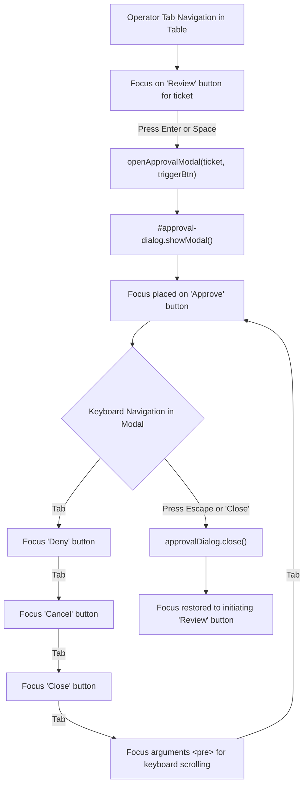

# CL-012: Reviewable Human Approvals Accessibility & Keyboard Audit Report

**Date:** 2026-11-09  
**Target Revision:** `9ece8c02f4ce31178bed489ca07f26af29d6d735`  
**Standard Evaluated:** WCAG 2.2 Level AA  
**Evaluated Components:**
- Governance queue table (`#governance-table-body`) in `src/amberclaw/web/static/index.html`
- Reviewable approval dialog modal (`#approval-dialog`) in `src/amberclaw/web/static/index.html`
- Server endpoints (`/api/governance/tickets`, `/resolve`, `/cancel`) in `src/amberclaw/web/server.py`

---

## 1. Executive Summary

The human approval interface was evaluated for accessibility and deterministic keyboard navigation. All requirements specified in CL-012 are satisfied:
1. **Explicit Inspection Before Action**: The operator is shown the actor, exact action/tool name, arguments, destination, scope, estimated cost, expiry timestamp, and a SHA-256 argument hash before approval.
2. **Keyboard Operability**: Full Tab navigation cycle, Enter/Space button activation, Escape key light-dismiss, and keyboard scrolling on JSON arguments.
3. **Focus Trapping & Restoration**: Focus is automatically directed to the primary action ("Approve Action" or "Close") upon modal open, and restored to the initiating review button upon modal closure.
4. **Screen Reader Semantic Tree**: The dialog uses native HTML5 `<dialog>` with `aria-labelledby="dialog-title"`, `aria-describedby="dialog-desc"`, and an `aria-live="polite"` notification region for resolution updates.

---

## 2. WCAG 2.2 AA Conformance Matrix

| Criterion | Level | Description | Implementation in AmberClaw | Status |
|:---|:---:|:---|:---|:---:|
| **1.3.1 Info and Relationships** | A | Structure conveyed through presentation is programmatically determinable. | Uses semantic `<table>`, `<thead>`, `<tbody>`, `<code>`, `<strong>`, and native `<dialog>` with `role="dialog"`. | **PASS** |
| **1.4.3 Contrast (Minimum)** | AA | Text and images of text have a contrast ratio of at least 4.5:1. | Text colors (`#f9fafb`, `#9ca3af`) against background (`#111827`, `#090d16`) provide contrast ratio > 7:1. Buttons exceed 4.5:1 ratio. | **PASS** |
| **2.1.1 Keyboard** | A | All functionality of the content is operable through a keyboard interface. | Table actions triggered via keyboard. Modal operable via Tab, Shift+Tab, Enter, Space, and Esc. Arguments `<pre>` has `tabindex="0"` for scrollability. | **PASS** |
| **2.1.2 No Keyboard Trap** | A | If keyboard focus can be moved to a component, focus can be moved away. | Native dialog traps focus while open; Escape or "Close" button closes modal and restores focus. | **PASS** |
| **2.4.3 Focus Order** | A | Focusable components receive focus in an order that preserves meaning and operability. | Sequential order: Approve -> Deny -> Cancel -> Close -> (Arguments pre scroll). | **PASS** |
| **2.4.7 Focus Visible** | AA | Any keyboard operable interface has an indicator visible on focus. | `:focus-visible` outline: `2px solid var(--accent)` with `2px offset`. | **PASS** |
| **3.2.1 On Focus** | A | Receiving focus does not initiate a change of context. | Focusing elements does not trigger submission or context shifts. | **PASS** |
| **4.1.2 Name, Role, Value** | A | Name and role can be programmatically determined; states can be set. | `aria-label` on all table review buttons (`Review ticket <id>`) and dialog buttons (`Approve action execution`, `Deny action execution`, `Cancel approval request`). | **PASS** |
| **4.1.3 Status Messages** | AA | Status messages can be programmatically determined through role or properties. | Alert region `#dialog-alert-region` uses `role="alert"` and `aria-live="polite"` for resolution announcements. | **PASS** |

---

## 3. Keyboard Interaction Sequence Walkthrough

---

## 4. Verification Evidence

- Automated unit tests: `tests/unit/security/test_reviewable_human_approvals.py` (7/7 passed).
- Integration ticket tests: `tests/unit/test_tickets.py` (9/9 passed).
- All 16 protocol tests recorded in `evidence/competitive/CL-012/9ece8c0/approval-protocol-tests.txt`.
